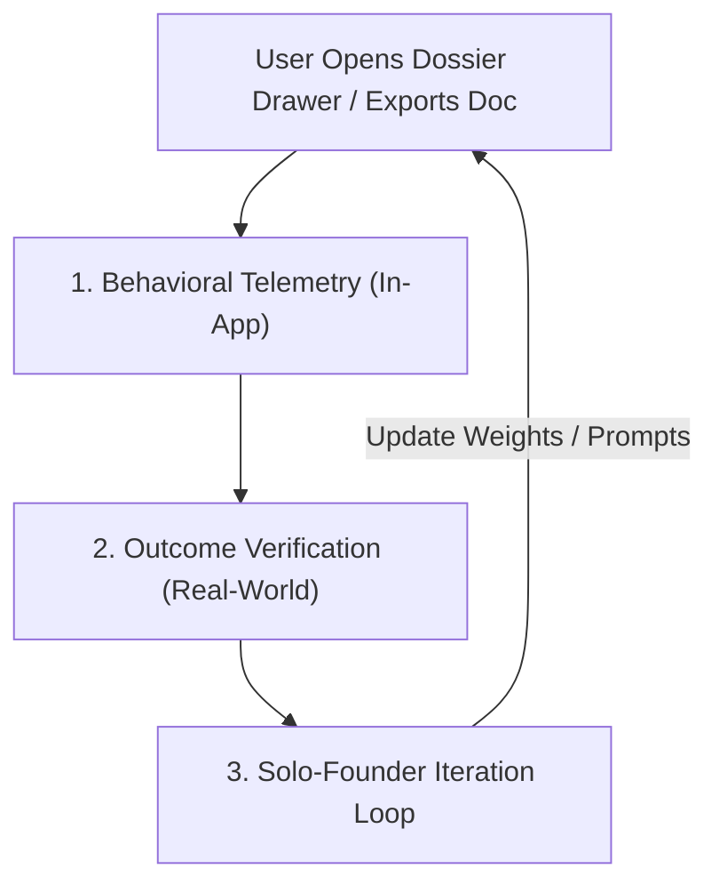

# Functional Product Requirements Document (Functional PRD)

**Document Title:** Backdoor — Company Intelligence & Executive Teardown Engine (M5)  
**Sprint Targets:** `S4-T02`, `S4-T03`, `S4-T06`  
**Version:** 2.2.0 (Zero-Migration Production Master)  
**Target Platform:** Next.js 15, Tailwind CSS, Supabase PostgreSQL, Google Workspace API  
**Database Architecture Decision:** **Zero-Migration** (Reusing existing `company_briefs` and `evaluations` JSONB columns)  

---

## 1. Product Overview & User Value Proposition

### 1.1 Executive Summary
The Company Intelligence Teardown Engine transforms raw corporate filings, earnings call transcripts, and disparate multi-channel user reviews into an authoritative, actionable **Executive Value Dossier**. In under 20 seconds, candidate users receive:
1. Product-scoped competitive intelligence.
2. Plain-English financial translations of corporate priorities.
3. 3 zero-solution diagnostic questions to ask the hiring manager.
4. A departmental opportunity pitch.
5. A dual-track 30–60–90 day execution blueprint presented as strategic options.

### 1.2 The High-Value Problem Solver Paradigm
This system fundamentally shifts candidate positioning:
* **From:** An applicant asking for an offer (*"What is your culture like?"*).
* **To:** An incoming strategic consultant presenting a diagnostic breakdown of the company's financial and operational leaks, offering collaborative paths to solve them.

---

## 2. Core Functional Requirements

---

### Feature `S4-T02`: Company Review Auditor & Friction Engine

#### 2.1 User Story
> *As a job seeker preparing for an interview, I want to see real customer complaints and unvarnished friction points from App Store, Reddit, G2, Trustpilot, and PissedConsumer inside the Dossier Drawer, so that I understand where the company's product is struggling before my interview.*

#### 2.2 Functional Requirements
* **FR-1.1 Customer Sentiment Meter:**
  * Render an aggregated visual sentiment score (0–100) at the top of Tab 3.
  * Color coding: Green ($\ge 75$), Amber ($50–74$), Red ($< 50$).
  * Display a percentage breakdown: `% Positive`, `% Neutral`, `% Critical`.
* **FR-1.2 Top 5 Friction Points Card:**
  * Render the top 5 distinct customer pain points extracted from multi-channel reviews.
  * Each friction card must display:
    * Friction Title (e.g., *"CSV Reporting Timeouts on Large Datasets"*).
    * Verbatim customer quote with quotation marks.
    * Review source badge with platform logo/tag: `Reddit`, `App Store`, `Play Store`, `G2`, `Trustpilot`, or `PissedConsumer`.
    * Reviewer verification indicator (e.g., *"Verified Buyer"* or *"Reddit Community Consensus"*).
    * Frequency indicator (e.g., *"Flagged in 14 reviews in past 60 days"*).
* **FR-1.3 Manual Re-Sync Control:**
  * Provide a "Refresh Review Analysis" button with animated loading spinner and last-updated timestamp.

---

### Feature `S4-T03`: Executive Product Teardown 1-Pager & Google Docs Exporter

#### 2.3 User Story
> *As a candidate, I want Backdoor to synthesize the company's business model and customer complaints into a structured 1-pager and export it to my Google Drive, so that I can bring an executive-ready proposal into my interview.*

#### 2.4 Functional Requirements
* **FR-2.1 Phased Proposal Cards:**
  * Render 3 structured proposal cards inside Tab 3 of the Dossier Drawer:
    1. **Horizon 1 (Quick Win — Days 0–30):** Immediate operational triage addressing the \#1 customer friction point.
    2. **Horizon 2 (Multiplier — Days 30–60):** System or workflow optimization multiplying retention or team velocity.
    3. **Horizon 3 (Strategic Moat — Days 60–90+):** Scalable monetization or competitive defense initiative.
  * Each card displays: `Problem Diagnosis` $\rightarrow$ `Proposed Action` $\rightarrow$ `Expected Metric/KPI`.
* **FR-2.2 Google Docs One-Click Exporter:**
  * Render a primary CTA button: **"Open Teardown in Google Docs"**.
  * On click, invoke the backend Google Docs generator (`docs.create` and `documents.batchUpdate`).
  * Open the newly generated document in a new browser tab using authenticated Drive URL.
  * Save Google Doc reference to `public.company_briefs.funding_details`.
* **FR-2.3 Proposal Regeneration:**
  * Display a "Regenerate Proposals" button with a dropdown allowing the candidate to select a strategic focus: *Retention Focus*, *Monetization Focus*, or *Technical Debt Triage*.

---

### Feature `S4-T06`: In-Drawer AI Copilot Panel & Role Sparring

#### 2.5 User Story
> *As a candidate inspecting a role, I want an interactive AI sparring partner right inside the drawer, so that I can practice defending my proposals and answering simulated case questions before speaking with the hiring manager.*

#### 2.6 Functional Requirements
* **FR-3.1 Drawer Integration & Keyboard Trigger:**
  * Collapsible slide-out sub-panel within the Dossier Drawer accessible via drawer cue icon or global shortcut `Cmd/Ctrl + K`.
* **FR-3.2 Streaming Markdown Chat Interface:**
  * Real-time streaming response via Server-Sent Events (SSE) with sub-second time-to-first-token.
* **FR-3.3 Quick-Action Prompt Chips:**
  * Chip A: *"Simulate 5-minute case interview question on our top customer complaint."*
  * Chip B: *"Draft objection handling for my career transition."*
  * Chip C: *"Highlight my top metrics for this JD."*
* **FR-3.4 Action Controls:**
  * "Copy Response" button with toast notification.
  * "Pin to Interview Notes" button that persists selected chat responses directly into `public.meeting_notes`.
* **FR-3.5 Rule R5 Safety Check:**
  * Enforce that the Copilot never invents candidate accomplishments or metrics not found in `M8: dossier/identity`.

---

### Feature FR-4: Product-Line Scoping Engine

#### 2.7 Functional Requirements
* **FR-4.1 Automatic Product-Line Detection:** Parse Job Title and Job Description to extract the target product or division (e.g., Target: *Uber* $\rightarrow$ Scoped Product: *Uber Freight*; Target: *HubSpot* $\rightarrow$ Scoped Product: *Service Hub*).
* **FR-4.2 Scoped Downstream Ingestion:** Append the scoped product name to all review queries and competitor comparisons to prevent parent-company noise.

---

### Feature FR-5: Plain-English Financial Translator & Business Model Engine

#### 2.8 Functional Requirements
* **FR-5.1 Public Company Financial Translator:**
  * Ingest SEC 10-K/10-Q (or international equivalent).
  * Automatically compute and translate core financial movements into plain-English strategic intent (e.g., *margin compression $\implies$ infrastructure/support costs; growing cash + flat dividends $\implies$ war chest for expansion*).
* **FR-5.2 Private Company Financial & News Ingestion:**
  * Crawl company website for Investor Relations / Press release sections.
  * Extract funding stage (Series A–F), total capital raised, lead investors, and recent M&A/partnerships (last 24 months) via Crunchbase and PR Newswire.
* **FR-5.3 Business Model Mechanics:**
  * Extract and state the exact revenue engine: *Enterprise seat-based SaaS, consumption/usage tiers, two-sided marketplace take-rate, or transaction interchange fees*.

---

### Feature FR-6: 1–3 Year Strategic Priorities & Leadership Compass

#### 2.9 Functional Requirements
* **FR-6.1 Executive 1–3 Year Priorities:** Extract top 3–5 strategic priorities declared by leadership with direct quotes from earnings calls and press releases.
* **FR-6.2 Leadership Team Profile Cards:** Display summary cards for key leadership (CEO, CTO, CMO, and target VP/Director) with public LinkedIn milestones.

---

### Feature FR-7: Product-Scoped Competitor SWOT Engine

#### 2.10 Functional Requirements
* **FR-7.1 Competitor Mapping:** Automatically resolve the top 3–5 competitors for the specific product line.
* **FR-7.2 Structured SWOT Grid:** Provide Strengths, Weaknesses (from G2/Capterra), Opportunities, and Threats (from competitor migration campaigns).

---

### Feature FR-8: Universal Strategic Communication Package

#### 2.11 Functional Requirements
* **FR-8.1 Three Zero-Solution Diagnostic Questions:**
  * Formulate 3 exploratory questions for the hiring manager that **withhold solutions** and expose internal constraints:
    1. *Macro/Financial Question:* References 10-K/runway to explore budget trade-offs.
    2. *Competitor/Product Question:* References G2 friction and rival positioning to explore strategic priorities.
    3. *Internal Execution Question:* References sprint velocity or tech debt to uncover departmental bottlenecks.
* **FR-8.2 2–3 Conversation Progression Pitch:**
  * Generate the multi-round conversational ladder: Call 1 (Problem Validation) $\rightarrow$ Call 2 (Departmental Opportunity Sizing) $\rightarrow$ Call 3 (Strategic Alignment).
* **FR-8.3 Skill Transference Formula:**
  * Apply: `Diagnosed Departmental Problem` $\implies$ `Candidate Verified Proof Metric (Rule R5)` $\implies$ `Immediate Departmental Application`.
* **FR-8.4 Dual-Track 30–60–90 Day Menu of Options:**
  * Structure roadmap as **two viable strategic paths**:
    * **Track A (Velocity Path):** Immediate tactical triage, quick-win patches, fast SLA recovery.
    * **Track B (Scalability Path):** Deep telemetry, root-cause architectural refactor, long-term capability packaging.
  * Collaborative closing prompt: *"Given your quarterly OKRs, which of these two paths takes more pressure off your desk right now?"*

---

### Feature FR-9: Source Transparency & Verification Badges

#### 2.12 Functional Requirements
* **FR-9.1 Visual Verification Badges:**
  * `[VERIFIED: SEC 10-K / STATUTORY REGISTRY]` (Blue Badge — Tier 1)
  * `[VERIFIED: REVIEW CONSENSUS (N=X)]` (Emerald Badge — Tier 2)
  * `[INFORMED INFERENCE]` (Purple Badge — Tier 3)
* **FR-9.2 Citation Links:** Clicking any badge opens a modal showing source URL, publication date, and verbatim quote.

---

## 3. Data Architecture: The Zero-Migration Decision

To eliminate database migration risk, zero downtime, and zero schema alteration overhead, the engine persists all intelligence into **existing PostgreSQL JSONB columns** in `database/schema.sql`:

```
┌────────────────────────────────────────────────────────────────────────┐
│ EXISTING TABLE: public.company_briefs (Global Company Cache)           │
│ • company_id (UUID, UNIQUE)                                            │
│ • one_sentence_summary (TEXT)       ──> The Discrepancy Hook Statement │
│ • funding_details (TEXT)            ──> Headless Google Doc URL        │
│ • recent_news (JSONB)               ──> Data Product Entity Payload    │
│ • fetched_at (TIMESTAMPTZ)          ──> 30-Day TTL Cache Anchor        │
├────────────────────────────────────────────────────────────────────────┤
│ EXISTING TABLE: public.evaluations (Role-Scoped Synthesis)             │
│ • user_id + job_id + track_id (UNIQUE)                                 │
│ • strategic_positioning_angle (TEXT)──> Departmental Opportunity Pitch │
│ • tier2_breakdown (JSONB)           ──> 3 Diagnostic Questions         │
│ • why_you_excel (JSONB)             ──> Dual-Track 30-60-90 Roadmap    │
│ • score_booster_gaps (JSONB)        ──> 5-Stakeholder Pitch Arsenal    │
└────────────────────────────────────────────────────────────────────────┘
```

---

## 4. Measuring User Impact & Solo-Founder Continuous Improvement

To measure whether this intelligence engine actually helps candidates secure offers and iterate rapidly as a solo founder, the platform implements a 3-layer feedback flywheel:



### 4.1 Core Telemetry & Impact Metrics

| Metric | Target Goal | Measurement Method | Why It Matters |
| :--- | :--- | :--- | :--- |
| **Doc Export Rate** | $\ge 45\%$ | Ratio of candidates clicking "Open Teardown in Google Docs" on high-match jobs ($\ge 70$). | Proves candidate considers the output executive-ready for real interviews. |
| **Question Copy Rate** | $\ge 60\%$ | Click tracking on "Copy Diagnostic Questions" inside Drawer Tab 3. | Proves candidate intends to ask these exact questions in their upcoming call. |
| **Copilot Sparring Velocity** | $\ge 2.5\text{ turns/session}$ | Average message exchanges in In-Drawer Copilot (`Cmd+K`). | Measures active interview practice vs. passive consumption. |
| **Interview Advancement Uplift** | $\ge 35\%$ | Application state progression in `evaluations.stage` (`APPLIED` $\rightarrow$ `INTERVIEWING` $\rightarrow$ `OFFER`). | The ultimate business metric: Does this approach win more job offers? |

### 4.2 Candidate In-App Feedback Mechanism
Inside Tab 3 and Copilot, provide low-friction single-click feedback buttons:
* 👍 *"This accurate friction point came up in my interview."*
* 👎 *"The interviewer said this bug was fixed 6 months ago."* (Automatically invalidates company cache and biases scraper weights to reviews from the last 60 days).
* **"Mark as Used in Interview" Checkbox:** On the 0–30–60–90 day proposals, allowing candidates to report post-interview: *"Did the hiring manager react positively?"*

### 4.3 Solo-Founder Iteration Loop (How to Improve the Flow)
1. **Weekly Stale Cache Review:** A simple weekly SQL query checks companies with $\ge 2$ thumbs-down ratings to inspect where the scraper failed.
2. **Scraper Failure Fallback Telemetry:** If a review site blocks crawling (HTTP 403), log the error to `decision_events` without crashing the user flow, and automatically shift weight to alternate open sources.
3. **Storage & Cost Cap:** Zero database cost overhead. The JSONB payload occupies $\le 2.5\text{ KB}$ per company in `company_briefs`, allowing 200,000 companies to sit inside free-tier Supabase indefinitely.
