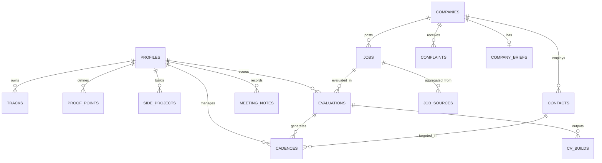

# Three Doors (backdoorv.1): Information Architecture (IA) Specification

**Document Version:** backdoorv.1  
**Target:** Information Hierarchy, Entity Structures, Metadata Taxonomy & Route Map  
**Status:** Approved for Implementation  

---

## 1. Information Hierarchy & Site Tree

```
Three Doors Root Application
│
├── /discover (Workspace 1: Discover & Triage)
│   ├── /discover/radar (Morning Radar: Top 20 roles >= 70 Fit)
│   ├── /discover/all (Full Feed: All 35 sources, active filters)
│   ├── /discover/closed (Historical & Verified Closed Openings)
│   └── /discover/[job_id] (Slide-Out Dossier Drawer View)
│
├── /dossiers (Workspace 2: Persona Tracks & Proof Points)
│   ├── /dossiers/tracks (Track Manager: AI-Native PM, Growth PM, UX PM)
│   ├── /dossiers/proof-points (Structured Metric Bullets & Evidence URLs)
│   ├── /dossiers/side-projects (AI-Native Repos & Deployed Demo Links)
│   └── /dossiers/competency-map (Financial Domain -> PM Pillar Translation)
│
├── /outreach (Workspace 3: Cadence & Communications)
│   ├── /outreach/board (Cadence Kanban Board by Step Status)
│   ├── /outreach/drafts (Gmail Drafts Waiting for Review)
│   ├── /outreach/active (Dispatched Outreach with Thread Monitoring)
│   └── /outreach/archive (Completed or Bounced Outreach)
│
├── /interviews (Workspace 4: Notes, Meetings & Actions)
│   ├── /interviews/calendar (Google Calendar Synced Events)
│   ├── /interviews/notes (Parsed Transcripts & Action Items)
│   └── /interviews/sheet-mirror (Google Sheets Downstream Mirror Status)
│
├── /health (System Observability: Source Health)
│   └── /health/sources (Status, Latency, Error Logs across 35 Sources)
│
└── /settings (System Configuration)
    ├── /settings/sources (Per-Source Toggles & BYOK API Keys)
    ├── /settings/filters (Title Exclusions, Excluded Companies & Industries)
    ├── /settings/google (Google OAuth Tokens, Scopes, Drive Folder Setup)
    └── /settings/account (Profile Details, Target Countries, Data Export/Delete)
```

---

## 2. Core Entity Architecture & Taxonomy



### 2.1 Entity Taxonomy Definitions

#### A. Canonical Job Entity (`jobs`)
*   **Unique Identity:** Normalized `dedup_match_key` (normalized company name + normalized job title).
*   **Taxonomy Fields:**
    *   *Workplace:* `remote` | `hybrid` | `on-site`.
    *   *Seniority Level:* `entry` | `mid` | `senior` | `staff` | `lead` | `director`.
    *   *Region:* `India` | `US` | `UK` | `EU` | `Global Remote`.
    *   *Posting Lifecycle:* `OPEN` | `STALE` (>60 days) | `CLOSED` (HTTP verified 404/redirect).

#### B. The Three Doors Entity (`contacts`)
*   **Door Classification:**
    *   `DOOR_1`: Decision Maker (Founder, Head of Product, VP of Product, Group PM).
    *   `DOOR_2`: Gatekeeper (Technical Recruiter, Talent Partner, Head of Talent).
    *   `DOOR_3`: Ally / Referral (Peer PM, Senior IC, Ex-Employee).
*   **Confidence State:** `VERIFIED` | `PROBABLE` | `UNVERIFIED` (pattern guess) | `CURATED`.
*   **Data Minimum:** Strict exclusion of phone numbers, home cities, personal social media accounts, or personal photos.

#### C. Evaluation Entity (`evaluations`)
*   **Tiers Hierarchy:**
    *   *Tier 1 (Gate):* Boolean pass/fail based on location, remote boundary, visa constraints, and excluded industries (FinTech/Payments).
    *   *Tier 2 (Formula Match):* Integer 0–100 calculated deterministically (Skills Overlap 60 pts + Experience Gap 25 pts + Seniority Gap 15 pts).
    *   *Tier 3 (Dossier Synthesis):* Generative synthesis (executed only if Tier 2 score $\ge 70$ on BYOK AI key).
*   **Score Buckets:**
    *   `Top Fit`: Score 70–100 (triggers automated CV doc cloning and draft generation).
    *   `Exploratory`: Score 40–69 (requires manual candidate review).
    *   `Stretch`: Score 0–39 (ineligible or high experience gap).

#### D. Cadence Entity (`cadences`)
*   **Lifecycle States:** `DRAFT_PENDING` $\to$ `DRAFT_CREATED` $\to$ `SENT` $\to$ `REPLIED` (or `BOUNCED` / `CANCELLED`).
*   **Channel Attributes:** `GMAIL` (subject, draft body, PDF attachment link) | `LINKEDIN_NOTE` (character count $\le 300$).
*   **Timing Attributes:** `suggested_send_at` (Tuesday–Thursday at 09:15 AM recipient local time) and `sent_at` (actual human dispatch timestamp).

---

## 3. Metadata & Search Taxonomy

To enable instant filtering across 100+ opportunities in the Dense Command Table, the application indexes the following facets:

| Facet Dimension | Filter Type | Valid Values / Behavior |
| :--- | :--- | :--- |
| **Score Bucket** | Single Select / Pills | `All`, `Top Fit (70+)`, `Exploratory (40-69)`, `Stretch (<40)` |
| **Track** | Dropdown | `AI-Native PM`, `Growth PM`, `UX PM` |
| **Work Model** | Multi-Select | `Remote Only`, `Hybrid`, `On-site` |
| **Target Region** | Multi-Select | `India`, `United States`, `United Kingdom`, `European Union` |
| **Source Group** | Multi-Select | `ATS Direct`, `Remote Boards`, `Startup Boards`, `Pasted / Ingest` |
| **Posting Date** | Range / Preset | `Past 24 Hours`, `Past 7 Days`, `Past 30 Days` |
| **Door Discovery** | Checkbox Filter | `Has Door 1 Contact`, `Has Verified Email` |
| **Status Stage** | Multi-Select | `Discovered`, `Chosen`, `Outreach Started`, `In Conversation` |
