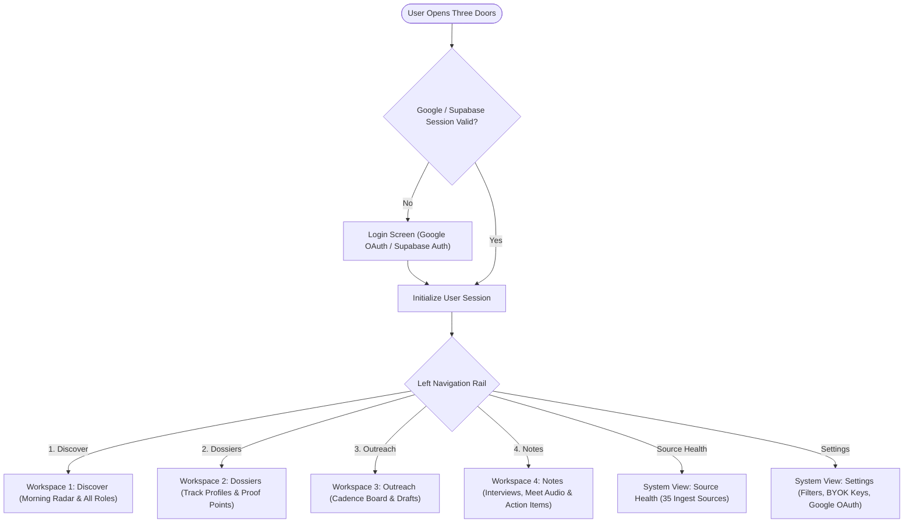
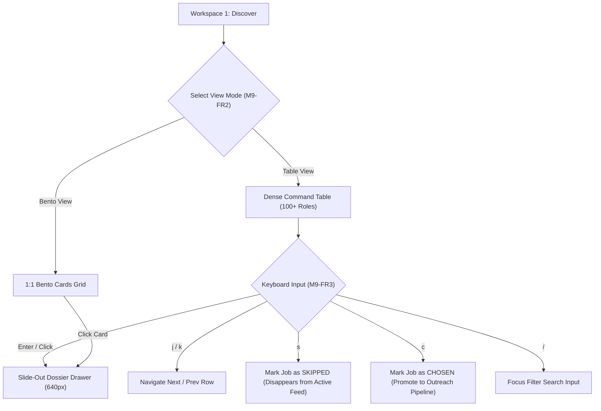
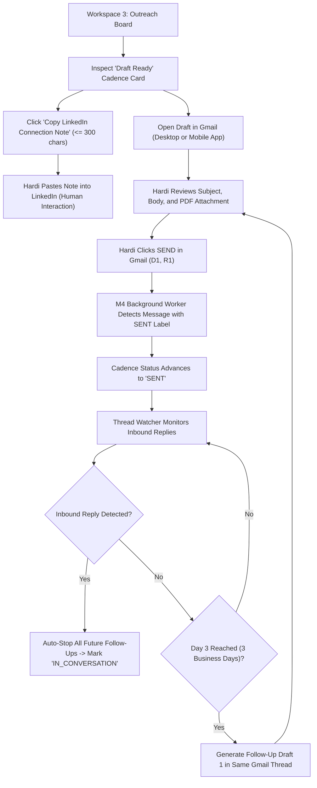
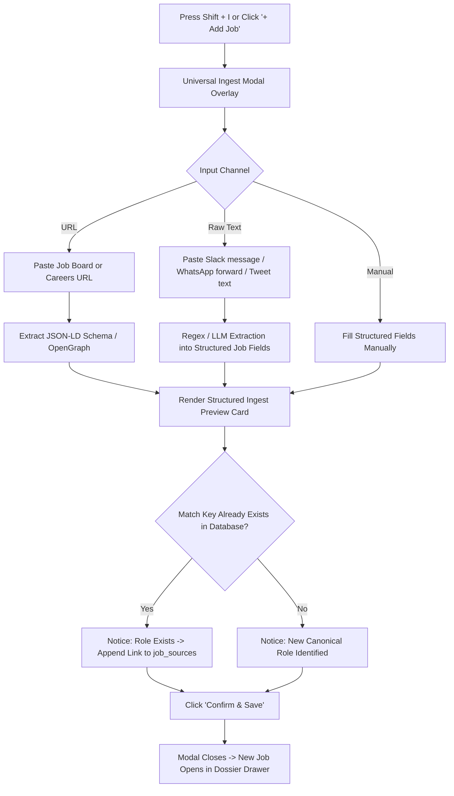

# Three Doors (backdoorv.1): Navigation Flow Specification

**Document Version:** backdoorv.1  
**Target:** User Navigation Flows, Screen State Transitions & Modal Overlays  
**Status:** Approved for Implementation  

---

## 1. Top-Level Workspace Navigation Flow

The candidate navigates between 4 primary workspaces on the left navigation rail, plus system configuration pages:



---

## 2. Morning Discovery & Triage Navigation Flow



---

## 3. Slide-Out Dossier Drawer In-Depth Navigation

The slide-out drawer operates as a persistent, zero-reload inspection surface:

```mermaid
flowchart TD
    OpenDrawer["Open Dossier Drawer (640px)"] --> DrawerTabs{"Drawer Tab Navigation"}
    
    DrawerTabs -->|Tab 1: Spec| JobSpec["Job Spec (Markdown, Original Apply Links)"]
    DrawerTabs -->|Tab 2: Match| MatchEval["3-Tier Breakdown (Tiers 1, 2, 3 + Booster Gaps)"]
    DrawerTabs -->|Tab 3: Intel| TeardownTab["Company Brief + 3 Opportunities Teardown"]
    DrawerTabs -->|Tab 4: Doors| DoorsTab["Door 1 (HM), Door 2 (Recruiter), Door 3 (Peer)"]
    DrawerTabs -->|Tab 5: Draft| DraftTab["Tailored CV PDF Link + Gmail Draft Body Preview"]
    
    OpenDrawer --> KeyCycle{"Drawer Keyboard Controls"}
    KeyCycle -->|↑ Arrow| PrevJob["Instantly Load Previous Job (No Page Reload)"]
    KeyCycle -->|↓ Arrow| NextJob["Instantly Load Next Job (No Page Reload)"]
    KeyCycle -->|Esc / [X]| CloseDrawer["Close Drawer (Return to Active Table Row)"]

    DraftTab --> StartOutreachBtn{"Click 'Start Outreach'"}
    StartOutreachBtn --> RunM7["Trigger M4 PDF Export + M7 Gmail Draft Creation"]
    RunM7 --> DrawerFeedback["Status Updates to 'Draft Ready in Gmail'"]
```

---

## 4. Multi-Channel Cadence & Human Send Flow



---

## 5. Universal Ingest Modal Navigation Flow

The Universal Ingest Modal (M2-FR8) can be summoned from anywhere in the application via the top navigation bar or the global keyboard shortcut `Shift + I`:


