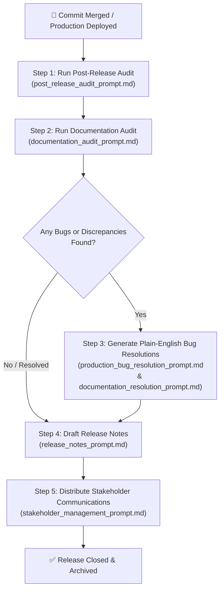

# Post-Release & Post-Commit Workflow Playbook

A step-by-step operating guide on how, when, and in what sequence to use each prompt document following the release of any commit, pull request, or production deployment.

---

## 🗺️ Prompt Suite Map

| Document | Purpose | Primary Audience |
| :--- | :--- | :--- |
| [post_release_audit_prompt.md](file:///Users/hardijain/backdoor/docs/prompts/post_release_audit_prompt.md) | Task-by-task audit, preview link verification, and human PR drafting | Engineering Leads, QA, Product Ops |
| [documentation_audit_prompt.md](file:///Users/hardijain/backdoor/docs/prompts/documentation_audit_prompt.md) | Catching documentation drift and verifying user guide accuracy | Technical Writers, Support, Product Managers |
| [production_bug_resolution_prompt.md](file:///Users/hardijain/backdoor/docs/prompts/production_bug_resolution_prompt.md) | Non-technical explanations of technical bugs and permanent guardrails | Clients, Non-Technical Stakeholders, Support |
| [documentation_resolution_prompt.md](file:///Users/hardijain/backdoor/docs/prompts/documentation_resolution_prompt.md) | Explaining doc inaccuracies, user confusion, and guide updates | Support Leads, Account Managers, Clients |
| [release_notes_prompt.md](file:///Users/hardijain/backdoor/docs/prompts/release_notes_prompt.md) | Customer-facing release notes highlighting value and preview links | Customers, Sales, Marketing, Community |
| [stakeholder_management_prompt.md](file:///Users/hardijain/backdoor/docs/prompts/stakeholder_management_prompt.md) | 3-tiered communication (Executive Briefing, Internal Sync, Advisory) | Executives, Cross-functional Partners, Clients |

---

## ⏱️ Step-by-Step Sequence After Any Commit / Release

---

### Step 1: Conduct the Post-Release Audit & Draft Approval PR
* **When to run:** Immediately after code is deployed to staging or production (0–2 hours post-release).
* **Which prompt:** [`post_release_audit_prompt.md`](file:///Users/hardijain/backdoor/docs/prompts/post_release_audit_prompt.md)
* **What you feed into it:**
  - Sprint task list or PR descriptions.
  - Staging/Preview URLs (e.g., Vercel preview links or test environment URLs).
  - Telemetry and test results (Pass/Fail).
* **What you get:**
  1. A structured health report evaluating system stability, customer reception, and task verification.
  2. A ready-to-review Pull Request template with preview links for human sign-off.
* **Action item:** Share the drafted PR with the human reviewer/team lead for formal approval.

---

### Step 2: Audit Documentation Against the Live Release
* **When to run:** Concurrently with Step 1, before announcing features to users.
* **Which prompt:** [`documentation_audit_prompt.md`](file:///Users/hardijain/backdoor/docs/prompts/documentation_audit_prompt.md)
* **What you feed into it:**
  - List of modified features, UI shifts, or removed buttons from the release.
  - Existing user guides, knowledge base articles, or runbook links.
* **What you get:**
  - A prioritized gap analysis showing where documentation drifted from actual software behavior.
  - Required edits and obsolete screenshot deprecation lists.
* **Action item:** Update and republish any outdated guides before external users encounter them.

---

### Step 3: Address Any Bugs or Drift in Plain English
* **When to run:** Whenever a defect is found during verification or reported by early users.
* **Which prompts:**
  - For software/system bugs: [`production_bug_resolution_prompt.md`](file:///Users/hardijain/backdoor/docs/prompts/production_bug_resolution_prompt.md)
  - For misleading guides/runbooks: [`documentation_resolution_prompt.md`](file:///Users/hardijain/backdoor/docs/prompts/documentation_resolution_prompt.md)
* **What you feed into them:**
  - Raw error logs, stack traces, bug tickets, or customer support transcripts.
* **What you get:**
  - A 4-part plain-English summary: Impact -> Why It Happened -> How It Was Fixed -> Guardrail Added.
* **Action item:** Attach this non-technical summary to client tickets and executive status boards.

---

### Step 4: Publish Customer-Facing Release Notes
* **When to run:** Once all tasks are verified on production and the human approval PR is signed off.
* **Which prompt:** [`release_notes_prompt.md`](file:///Users/hardijain/backdoor/docs/prompts/release_notes_prompt.md)
* **What you feed into it:**
  - Git commit history (`git log --oneline`), merged PR titles, and verified preview links.
* **What you get:**
  - Engaging, benefit-driven Release Notes categorized by "What's New", "Improvements", and "Bug Fixes".
* **Action item:** Publish to the user changelog, app banner, blog, or product newsletter.

---

### Step 5: Distribute Multi-Tiered Stakeholder Communications
* **When to run:** At the conclusion of the release cycle (same day or next morning).
* **Which prompt:** [`stakeholder_management_prompt.md`](file:///Users/hardijain/backdoor/docs/prompts/stakeholder_management_prompt.md)
* **What you feed into it:**
  - The completed audit findings from Step 1, release notes from Step 4, and any resolved incidents from Step 3.
* **What you get:**
  1. **Executive Briefing:** 3 bullets focused on business impact and risk mitigation for leadership.
  2. **Cross-Functional Sync:** Practical talking points for Sales, Support, and Marketing.
  3. **Customer Advisory:** Friendly, reassuring announcement for clients and end users.
* **Action item:** Deliver each artifact to its respective Slack channel, email distribution list, or meeting agenda.

---

## ⚡ Quick-Reference Checklist for Every Commit Release

- [ ] **1. Audit:** Run `post_release_audit_prompt.md` with task list and preview URLs.
- [ ] **2. PR Review:** Submit drafted PR with clickable preview links for human sign-off.
- [ ] **3. Docs:** Run `documentation_audit_prompt.md` to prevent doc drift.
- [ ] **4. Bug Translations:** If bugs occurred, run `production_bug_resolution_prompt.md`.
- [ ] **5. Release Notes:** Run `release_notes_prompt.md` to produce user-facing updates.
- [ ] **6. Stakeholders:** Run `stakeholder_management_prompt.md` to notify executives, teams, and clients.
