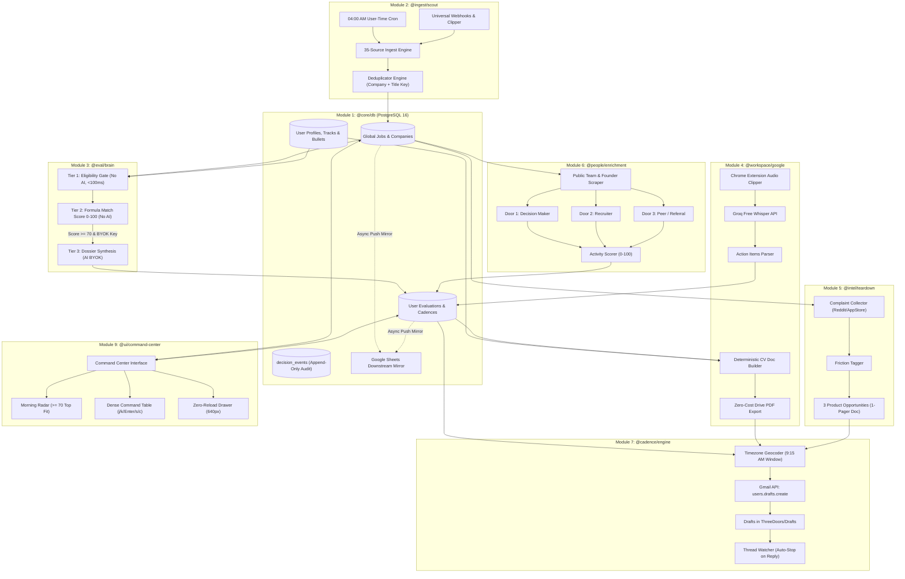
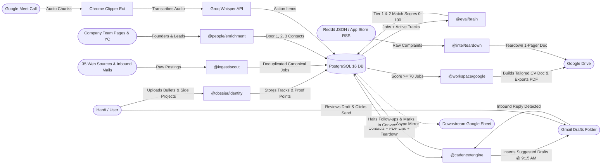
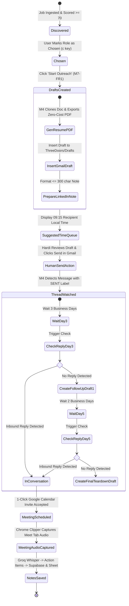

# Three Doors (backdoorv.1): System Architecture Maps

**Document Version:** backdoorv.1  
**Target:** Monorepo System Architecture, Data Flow & State Transitions  
**Status:** Approved for Implementation  

---

## 1. End-to-End Subsystem Architecture Map

---

## 2. Level 1 Data Flow Diagram (DFD)

---

## 3. Multi-Channel Cadence & Decision State Machine

